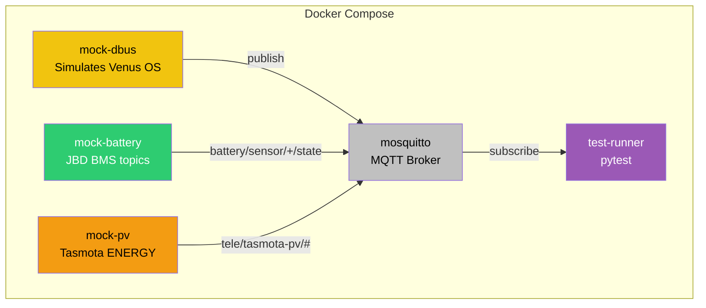

# Integration Tests

[](https://www.bestpractices.dev/en/projects/15554)

[](docs/fuzzing.md)

[](https://opensource.org/licenses/MIT)
[](https://github.com/victron-venus/integration-tests/actions/workflows/integration.yml)
[](https://www.python.org/downloads/)
[](https://www.docker.com/)

Environment for testing the complete data flow:
- MQTT broker (eclipse-mosquitto:2)
- Mock D-Bus (simulates Venus OS)
- Mock battery publisher (JBD BMS MQTT topics)
- Mock PV publisher (Tasmota energy topics)
- pytest test runner

Optional services (uncomment in `docker-compose.yml` when Dockerfiles exist):
- inverter-control
- inverter-dashboard-go

<!-- ci-release-process:start -->
## CI and deployment

See [CI and release operations](docs/release-workflow.md) for required checks and local commands. This repository publishes versioned source archives through beta and RC channels under the [release strategy](RELEASING.md). Public RCs also run the offline [fuzzing campaigns](docs/fuzzing.md).
<!-- ci-release-process:end -->

## Architecture



## Quick Start

```bash
# Run all tests
docker compose up --abort-on-container-exit

# Run specific test
docker compose run test-runner pytest tests/integration/test_mqtt_flow.py -v

# Watch logs
docker compose logs -f test-runner

# Cleanup
docker compose down -v
```

## Test Scenarios

### MQTT Flow (`test_mqtt_flow.py`)
- MQTT pub/sub roundtrip
- Inverter state publishing to `inverter/state`
- State JSON format validation
- WebSocket state propagation (when dashboard-go is enabled)

### Battery & PV Mocks (`test_battery_pv_mocks.py`)
- Battery SOC, voltage on `battery/sensor/+/state` topics
- Tasmota PV power on `tele/tasmota-pv/#` topics

### D-Bus Battery/PV Scenarios (`test_dbus_battery_pv.py`)
- **Battery D-Bus**: SOC oscillation, voltage range, current polarity, state aggregation
- **PV D-Bus**: SystemType payload, grid power noise, Ve.Bus state=9 (Inverting)
- **End-to-end**: Concurrent battery+PV publishing, PV power updates, cell voltage consistency
- **Control loop latency**: D-Bus → MQTT propagation under 5 seconds

## CI

The quality gate invokes `.github/workflows/integration.yml` for pull requests and release qualification. The integration workflow also supports explicit dispatch and reusable calls.

Manual dispatch supported via GitHub Actions UI.

### Reusable workflow (required status check)

Consumer projects (`inverter-control`, `inverter-dashboard`, `inverter-dashboard-go`) call this via `workflow_call` and add the resulting job as a **required check** in their branch protection rules.

#### Add to consumer workflow

```yaml
# .github/workflows/ci.yml
jobs:
  integration-tests:
    uses: victron-venus/integration-tests/.github/workflows/integration.yml@main
```

#### Set required check in branch protection

1. Repo **Settings → Branches → Branch protection rules** for `main`.
2. Under **Status checks that are required**, add the check named:
   - `integration-tests / Integration Tests` — the final aggregate for a consumer job named `integration-tests`
3. Enable **Require status checks to pass before merging**.

> The final aggregate job key is `integration-status`, with display name `Integration Tests`. Select the actual check reported by your reusable caller; the aggregate requires both dashboard variants and the hardware safety contracts.

### Artifacts

Each run uploads (retention: 7 days):
- `integration-test-report-<dashboard>.html` — HTML test report
- `integration-junit-<dashboard>.xml` — JUnit XML
- `integration-logs-<dashboard>/` — container/stack logs

## Completed Features

- Hardened CI runners, isolated integration projects, and uploaded test reports.

## Debugging

```bash
# Watch MQTT traffic
docker compose exec mqtt-broker mosquitto_sub -v -t '#'

# Check control publishes
docker compose exec mqtt-broker mosquitto_sub -v -t 'inverter/#'

# Test MQTT manually
docker compose run --rm test-runner python -c "
import paho.mqtt.client as mqtt
c = mqtt.Client()
c.connect('mqtt-broker', 1883)
c.subscribe('inverter/#')
c.loop_forever()
"
```


## CI dashboard coverage

The integration workflow builds Python and Go dashboards from the immutable source
revisions listed in its flat matrix. Missing builds, unavailable services and missing
WebSocket state propagation fail the job. Reports are written to a host-mounted
`reports/` directory and uploaded even after failures.

The controller has no dashboard WebSocket endpoint, so it is not a dashboard matrix
entry. These tests simulate its `inverter/state` output and verify real broker-to-dashboard
propagation; they do not claim to run the hardware control loop. Controller behavior is
covered by the inverter-control repository's hardware-free unit tests.

Run the mock-only profile as before, or use `docker-compose.ci.yml` with a locally built
`dashboard-under-test:ci` image to require dashboard readiness and message propagation.

## Contributing and security

See [CONTRIBUTING.md](CONTRIBUTING.md) for reports, development checks and pull requests,
[SECURITY.md](SECURITY.md) for private vulnerability reporting and deployment trust boundaries,
and the [OpenSSF evidence index](docs/openssf-evidence.md) for assessment references and remaining verification.

## Physical release acceptance

Physical testing is separate: see the [opt-in Cerbo runner](hardware/README.md)
and [release artifact/target acceptance contract](hardware/RELEASE_ACCEPTANCE.md).
The offline plan, unit tests and Docker matrix never qualify a physical device
or thermostat, even when all hosted jobs are green.

See [governance](GOVERNANCE.md), [community conduct](CODE_OF_CONDUCT.md) and
[the architecture, assurance scope and roadmap](docs/project-assurance.md).
The live OpenSSF assessment reports the achieved level and remaining criteria.
